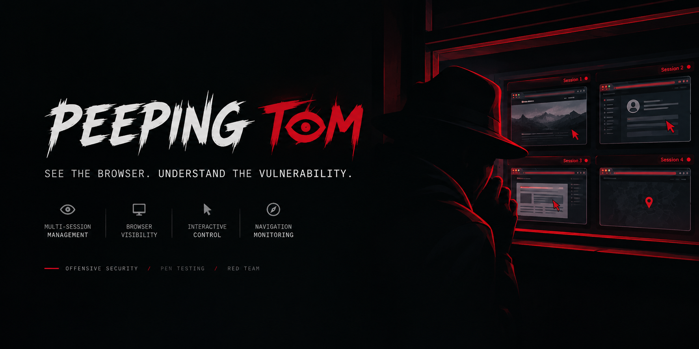
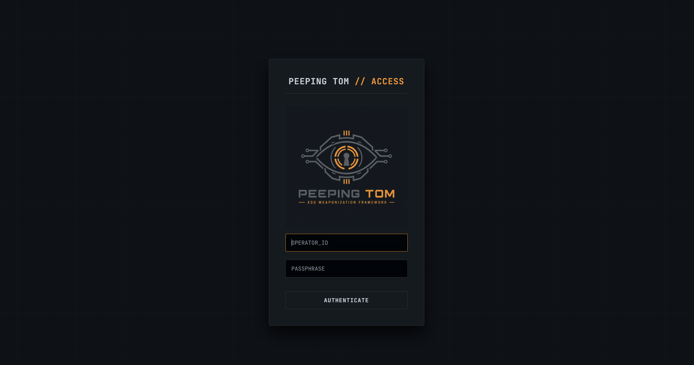
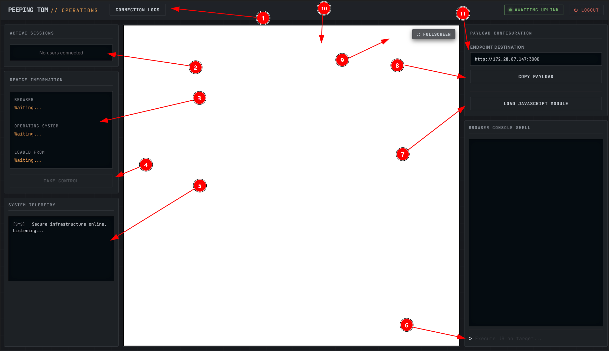
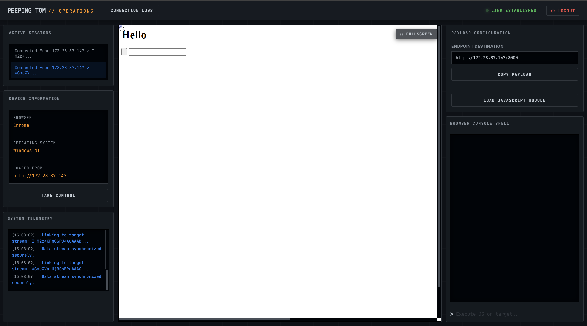

<p align="center"> <strong> XSS WEAPONIZATION FRAMEWORK</strong> </p>


---

## 🕶️ Overview

**Peeping Tom** is an XSS-focused security research framework designed to explore the post-exploitation implications of cross-site scripting vulnerabilities.

Built with Node.js, SQLite, and Docker, the project provides a centralized web-based operator console for managing multiple browser test sessions and examining the potential impact of client-side JavaScript execution.

Rather than treating XSS as a simple proof-of-concept alert, Peeping Tom explores the broader implications of browser-side execution in authorized penetration tests and controlled security laboratories.


## ⚡ Features

- **👁️ Operator Console** — A centralized web interface for managing the testing environment.
    
- **🔗 XSS Payload Generation** — Generate payloads for authorized security research.
    
- **👥 Multi-Session Management** — Organize and monitor multiple test sessions.
    
- **🐳 Docker Deployment** — Containerized installation and operation.

    

_Feature availability depends on the current implementation. Review the source code to confirm the exact behavior of each component._

## 📽️ Preview 
### Login page


### Operators View 


1. View connection history and session logs.
2. Display a list of currently active sessions.
3. View device information.
4. Initiate remote session control.
5. Access monitoring and activity logs.
6. Execute JavaScript within the connected user's session.
7. Load custom JavaScript modules and scripts within the connected user's sessio.
8. Copy the generated payload.
9. Toggle the remote session view to fullscreen.
10. View the remote session screen.
11. Configure the payload's IP address (Peeping Tom's IP).

### Operators View with hooked sessions example



## 🏗️ Project Structure

```
peeping-tom/
├── data/
├── private/
│   └── operator.html
├── public/
│   ├── css/
│   │   └── operator.css
│   ├── js/
│   │   └── operator.js
│   ├── index.html
│   └── logo.png
├── docker-compose.yml
├── Dockerfile
├── package.json
└── server.js
```


## 🚀 Installation

### Requirements

- Docker
    
- Docker Compose
    
- Git
    

### 1. Clone the repository

```
git clone https://github.com/RoboGR00t/Peeping-Tom-Support.git
cd Peeping-Tom-Support
```

### 2. Build and start the application

```
docker compose up -d --build
```

This builds the Docker image and starts the application in the background.

### 3. Verify the container

```
docker ps
```

Confirm that the Peeping Tom container is running.

### 4. View application logs in order to obtain the admin login password for the C2 Interface

```
docker compose logs -f 
```

To inspect logs from a specific container:

```
docker logs -f peeping-tom-console
```

The container name may differ depending on your Compose configuration.

### 5. Access the web interface

If the application is configured to publish port `3000`, open the following address:

```
http://127.0.0.1:3000
```

Complete the authentication and initialization process configured by the application.

## ⚙️ Configuration

Review the following files before deployment:

- `docker-compose.yml` — Port mappings, services, and persistent volumes.
    
- `Dockerfile` — Container image and runtime configuration.
    
- `package.json` — Dependencies and application scripts.
    
- `server.js` — Server initialization, authentication, and application logic.
    

### Recommended Deployment Practices

- Keep the operator console restricted to authorized users.
    
- Use HTTPS for appropriately secured remote deployments.
    

## 🔬 Research Applications

Peeping Tom is intended for authorized security research and controlled testing, including:

- Studying the impact of cross-site scripting vulnerabilities.
    
- Evaluating intentionally vulnerable web applications.
    
- Demonstrating browser-side script execution risks.
    
- Testing defensive controls against XSS.
    
- Supporting authorized penetration-testing exercises.
    
- Improving developer awareness of client-side security boundaries.
    

Use isolated lab environments, dedicated test accounts, and synthetic data.

## 🛡️ Security Considerations

Cross-site scripting can allow injected JavaScript to execute in the context of a vulnerable website. Depending on the application and its protections, this may enable unauthorized actions or expose sensitive page content.

Defensive measures include:

- **Output encoding:** Encode untrusted content appropriately for its output context.
    
- **Safe DOM manipulation:** Avoid unsafe HTML insertion and dangerous JavaScript sinks.
    
- **Content Security Policy:** Deploy a carefully configured CSP as an additional defense.
    
- **Secure cookies:** Use appropriate `HttpOnly`, `Secure`, and `SameSite` attributes.
    
- **Strong authorization:** Validate permissions on the server for sensitive operations.
    
- **Session management:** Implement expiration, revocation, and appropriate monitoring.
    
- **Security testing:** Regularly assess applications for reflected, stored, and DOM-based XSS.
    

Remember that client-side controls alone cannot replace server-side authorization.

## 🗺️ Roadmap

- [ ] Remove external dependencies
    
- [ ] Add scroll functionality to payload
    
- [ ] Improve authentication and access controls


## 🤝 Contributing

Contributions that improve maintainability, reliability, documentation, and defensive security are welcome.

1. Fork the repository.
    
2. Create a feature branch.
    
3. Make your changes.
    
4. Test your changes in an authorized environment.
    
5. Submit a pull request describing the changes.

## ⚖️ Disclaimer

Peeping Tom is intended for educational purposes, authorized security research, and controlled penetration testing.

Users are responsible for obtaining explicit authorization before testing systems or interacting with browser sessions. Unauthorized access, surveillance, data collection, or code execution may violate applicable laws, privacy rights, and contractual obligations.

This software is provided **as is**, without warranties of any kind. It has not been represented as independently audited or production-ready.

The authors do not endorse unauthorized use of this project.

## 📜 License

Peeping Tom is licensed under the **GNU General Public License v3.0 (GPL-3.0)**.

You are free to use, study, modify, and redistribute this software under the terms of the license. Any redistribution of covered derivative works must comply with the applicable GPL-3.0 requirements.

## 👁️ Final Word

**Peeping Tom — XSS Weaponization Framework**

_Understand the vulnerability. Demonstrate the impact. Strengthen the defense._

<p align="center"> <sub>Built for authorized web-security research and controlled laboratory environments.</sub> </p>
